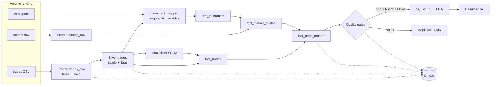

# ARCHITECTURE.md

Documento técnico para el equipo que mantiene el pipeline. Las decisiones y sus alternativas están en `docs/decisions/`; el contrato de cada tabla, en `docs/data_model.md`.

**Estado de implementación (2026-11-01).** Este documento describe el diseño completo, pero todavía no está todo construido:

| Parte | Estado |
|---|---|
| Entorno, helpers de escritura, calendario, profiling | Implementado |
| Bronze, Silver, instrumentos, cotizaciones, Gold, gates, EDA, IA, orquestador | Diseñado en `docs/specs/`, **no implementado** |
| Benchmark y comparativa de cómputo (§6) | **No ejecutado** |

Los números de este documento salen del notebook `01_data_profiling`, corrido en Free Edition sobre el CSV completo [MEDIDO, 2026-11-01; `notebooks_executed/01_data_profiling.ipynb`].

## 1. Contexto y objetivos no funcionales

El pipeline procesa ~100.000 operaciones de BYMA (02/01/2026 a 13/03/2026) en Databricks Free Edition: solo cómputo serverless, sin Jobs ni DLT, con Delta en todas las tablas (ADR-001).

| Objetivo | Cómo se cumple |
|---|---|
| **Trazabilidad** | Ninguna fila se descarta. Bronze preserva, Silver marca y Gold conserva todas las filas con `quality_status`. Toda fila lleva linaje hasta archivo y número de línea |
| **Idempotencia** | `MERGE` con clave determinista. Reejecutar con el mismo input deja las tablas idénticas |
| **Reproceso** | Los enriquecimientos viven separados de las operaciones: las cotizaciones se pueden volver a bajar sin tocar `fact_trades` |
| **Costo** | Costo cero en el challenge. En producción, ver §6 |

**Lo que el dato obliga a resolver** [MEDIDO]:
- 10.255 operaciones caen en sábado en hora local, 0 en domingo y 0 en Carnaval.
- Solo el 29,6% de las operaciones tiene hora local dentro de la rueda de 11 a 17.
- 13 filas tienen precio a más de ×50 o menos de ×1/50 de la mediana de su símbolo.
- 29 símbolos en ARS terminan en D o C, por lo que el sufijo no identifica la moneda.
- El 70,8% de los clientes hizo una sola operación.

## 2. Diagrama de flujo

## 3. Capas y contratos

Contrato completo en `docs/data_model.md`.

| Capa | Responsabilidad | Regla |
|---|---|---|
| Landing (Volume) | Archivos tal como llegan | No se modifican |
| Bronze | Columnas originales como texto, con linaje | Nunca `UPDATE`. Clave `(id_transaccion, record_hash)` |
| Silver | Tipado, fecha efectiva, flags de calidad | 1:1 con Bronze |
| Gold | Modelo estrella | Todas las filas, con `is_analytics_eligible` |
| `iol_ops` | Corridas, métricas, eventos, cobertura | Operativo |

## 4. Modelo de datos

**Por qué estrella (ADR-006).** Las preguntas de negocio son agregaciones por cliente, instrumento, canal y mes. Una One Big Table obligaría a reescribirla en cada cambio de SCD2, y Data Vault está sobredimensionado para una sola fuente.

**Granularidad:**
- `fact_trades`: una operación.
- `fact_market_quotes`: instrumento × día × proveedor.
- `fact_trade_market`: una por operación, separada de `fact_trades` porque tiene otro ciclo de vida.

**SCD2 de cliente (ADR-007).** El CSV solo trae `id_cliente`, así que se versionan atributos derivados, con snapshots al 31/01, 28/02 y 13/03. La versión de un corte rige desde el día siguiente, por lo que ninguna operación se asocia a información posterior. La viabilidad medida está en ADR-007.

## 5. Estrategia de escalabilidad

### 5.1 Ingesta incremental
Hoy hay un CSV único con `MERGE`, y `pandas` numera las filas porque serverless no tiene RDD. Eso no escala. En producción: Auto Loader o `COPY INTO` sobre landing particionado por fecha, con checkpoint por archivo y el mismo `record_hash` como clave. La trazabilidad de fila pasa a ser archivo + hash, sin número de línea.

### 5.2 Clustering y layout físico
Liquid clustering por `(effective_trade_date_key, instrument_sk)` en los hechos y por `client_id` en `dim_client` (ADR-012). No se particiona por fecha: a este volumen generaría archivos chicos. El efecto se mide a 100x; a 1x se espera una diferencia nula o mínima.

### 5.3 SCD2 incremental
Hoy son 3 snapshots completos. En producción: snapshot diario solo sobre clientes con actividad del día, con la misma función de aplicación.

### 5.4 Cotizaciones incrementales y caché
Las cotizaciones quedan en Delta y solo se piden los pares (símbolo, fecha) faltantes. `iol_ops.quote_requests` registra cada pedido.

### 5.5 Reprocesamiento
Por `ingestion_run_id` o rango de fechas. Silver reaplica reglas cuando cambia `rules_version`, y queda auditable.

### 5.6 Escenarios de volumen
[SUPUESTO] 1x = 100.000 operaciones, 10x = 1 millón, 100x = 10 millones. El volumen productivo real no está en el dato y hay que pedírselo a IOL.

## 6. Cómputo: comparativa y recomendación

**No ejecutado.** El benchmark corre Silver y Gold, que todavía no existen. Por eso no hay duraciones, costos ni recomendación. Las opciones a comparar están en ADR-010. Lo medido en Free Edition se va a etiquetar [MEDIDO] y lo extrapolado a producción [ESTIMADO].

## 7. Operación

Los notebooks de las etapas 02 en adelante son el diseño previsto; todavía no existen.

### 7.1 Correr el pipeline
1. Una vez por workspace: `00_setup` (schemas, Volume, chequeo del CSV).
2. Subir el CSV a `/Volumes/<catalog>/iol_bronze/landing/trades/`.
3. Abrir `00_run_pipeline` y usar Run all. Cada etapa recibe el mismo `pipeline_run_id`.

### 7.2 Reprocesar un rango o un archivo
Volver a correr desde la etapa afectada con `run_mode=from_stage`. Un archivo ya ingerido inserta 0 filas. Un archivo con cambios inserta solo las versiones nuevas y deja el conflicto a la vista (`DQ004`).

### 7.3 Agregar o corregir un instrumento
Un símbolo nuevo aparece como `DQ030_INSTRUMENT_UNMAPPED`. Se corre el notebook 04 (reglas e IA) y, si sigue ambiguo, se agrega un override en `src/iol_pipeline/mapping/overrides.csv` (ADR-004).

### 7.4 Qué hacer ante YELLOW o RED
Principio: lo estructural bloquea, lo analítico degrada. La tabla completa está en `docs/quality_gates.md`.
- **RED:** Gold no se usa y el EDA aborta con el motivo. Revisar reconciliación, filas CRITICAL y conflictos de ID.
- **YELLOW:** Gold se puede usar, y q1, q2 y q5 llevan advertencia si la causa es la cobertura de cotizaciones.

### 7.5 Rotar credenciales del proveedor de cotizaciones
Los secretos van por `dbutils.secrets` o variables de entorno, nunca en el repo. Hoy ningún proveedor elegido usa credenciales (ADR-008).

## 8. Limitaciones conocidas

- La semántica de `fecha` no está confirmada: que el sábado sea cola del viernes es [HIPÓTESIS] (ADR-003).
- Que los precios cerca de 0,01 o 1,00 de IOLnet sean un valor por defecto es [HIPÓTESIS] (ADR-005).
- El benchmark es de cierre diario: la hora de la operación no es confiable y no hay intradiario gratuito (ADR-009).
- Las fuentes de cotización tienen problemas propios medidos en el spike de 8 símbolos: una es un proyecto personal sin garantías, y las otras dan algunas series en otra escala o ajustadas (ADR-008).
- Los tests locales corren Spark 4.0 y Free Edition Spark 4.2 (ADR-001).
