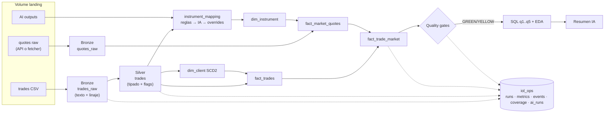

# Pipeline de operaciones bursátiles BYMA — IOL Data Engineering Challenge 2026

> Esqueleto del README entregable. **Completar cada `‹…›` solo con resultados del run final** (`pipeline_run_id: ‹…›`). Borrar este bloque antes de entregar.

Pipeline medallion en Databricks (Delta Lake) que ingiere ~100k operaciones de enero–marzo 2026, las valida sin descartar registros, las enriquece con cotizaciones de mercado y publica un modelo dimensional con historia de clientes (SCD2), controles de calidad y un componente de IA.

**Estado del último run:** Gold `‹GREEN|YELLOW›` · 100.000 operaciones trazadas · cobertura de cotizaciones `‹x›%` · tests `‹n› passed`

## Índice
1. [Arquitectura](#1-arquitectura)
2. [Cómo reproducir](#2-cómo-reproducir)
3. [Orden de ejecución](#3-orden-de-ejecución)
4. [Decisiones de diseño y trade-offs](#4-decisiones-de-diseño-y-trade-offs)
5. [Calidad de datos](#5-calidad-de-datos)
6. [Modelo dimensional y SCD2](#6-modelo-dimensional-y-scd2)
7. [Cotizaciones: fuente, mapeo, imputación y cobertura](#7-cotizaciones)
8. [Observabilidad, quality gates y performance](#8-observabilidad-quality-gates-y-performance)
9. [Hallazgos de negocio](#9-hallazgos-de-negocio)
10. [Componente de IA](#10-componente-de-ia)
11. [Cómputo productivo: comparativa](#11-cómputo-productivo)
12. [Tests y orquestación](#12-tests-y-orquestación)
13. [Limitaciones y próximos pasos](#13-limitaciones-y-próximos-pasos)

## 1. Arquitectura

Detalle para mantenedores: [`ARCHITECTURE.md`](ARCHITECTURE.md) · contrato de tablas: [`docs/data_model.md`](docs/data_model.md).

**Entorno:** Databricks Free Edition (Community Edition fue retirado el 1/1/2026; ver [ADR-001](docs/decisions/ADR-001-entorno-free-edition.md)). Sin Jobs ni DLT; orquestación con `dbutils.notebook.run()`; Delta en todas las tablas.

## 2. Cómo reproducir

1. Crear cuenta en Databricks Free Edition.
2. Workspace → Git folder → clonar este repo.
3. Subir el CSV a `/Volumes/workspace/iol_bronze/landing/trades/` (el dataset original no se publica; para probar, usar `data/sample_obfuscated.csv` — ver [`data/README.md`](data/README.md)).
4. Cotizaciones: ‹modo api (si hay egress) | correr `tools/quotes_fetcher` localmente y subir `data/quotes_raw/` a `landing/quotes/`›.
5. IA: ‹`ai_query` | subir outputs de `tools/ai_batch` a `landing/ai/`›.
6. Abrir `notebooks/00_run_pipeline` → Run all (widget `catalog` si no es `workspace`).
7. Tests locales: `pip install -r requirements-dev.txt && pytest -q` (Java 17+).

Notebooks ya ejecutados (con outputs): [`notebooks_executed/`](notebooks_executed/).

## 3. Orden de ejecución

| # | Notebook | Qué hace | Tablas que escribe |
|---|---|---|---|
| 00 | run_pipeline | Orquesta todo con `pipeline_run_id` | `iol_ops.pipeline_runs` |
| 01 | data_profiling | Evidencia de cada decisión | — |
| 02 | ingest_bronze | CSV → Bronze idempotente | `trades_raw`, `ingestion_runs` |
| 03 | quality_silver | Tipado, fecha efectiva, reglas | `silver.trades`, `quality_events` |
| 04 | instruments | Mapeo, variantes, escala | `instrument_mapping` |
| 09 | ai_enrichment | IA sobre instrumentos ambiguos | `ai_runs` |
| 05 | market_quotes | Cotizaciones, matching, cobertura | `fact_market_quotes`, `fact_trade_market`, `quote_coverage` |
| 06 | model_gold | Dimensiones, SCD2, hechos | `iol_gold.*` |
| 07 | quality_gate_monitoring | Gates + métricas + performance | `gold_status`, `pipeline_metrics` |
| 08 | business_eda_sql | q1..q5 + EDA | `eda_metrics` |
| 09b | ai_eda_summary | Resumen ejecutivo validado | `ai_runs` |

## 4. Decisiones de diseño y trade-offs

| # | Decisión | Trade-off | ADR |
|---|---|---|---|
| 1 | Free Edition respetando restricciones del challenge | ‹…› | [001](docs/decisions/ADR-001-entorno-free-edition.md) |
| 2 | Bronze en texto + MERGE por (id, hash), sin UPDATE | ‹…› | [002](docs/decisions/ADR-002-ingesta-idempotente.md) |
| 3 | Sábado → fecha efectiva viernes; hora no confiable | ‹…› | [003](docs/decisions/ADR-003-calendario-sabados.md) |
| 4 | Mapeo explícito de instrumentos; variantes como instrumentos distintos | ‹…› | [004](docs/decisions/ADR-004-mapeo-instrumentos.md) |
| 5 | Escala por 1 VN + sanity check; errores de escala marcados, no corregidos | ‹…› | [005](docs/decisions/ADR-005-escala-precios.md) |
| 6 | Estrella con hecho de mercado separado | ‹…› | [006](docs/decisions/ADR-006-modelo-estrella.md) |
| 7 | SCD2 por snapshots mensuales sobre atributos derivados | ‹…› | [007](docs/decisions/ADR-007-segmentacion-scd2.md) |
| 8 | Fuente de cotizaciones ‹…› | ‹…› | [008](docs/decisions/ADR-008-fuente-cotizaciones.md) |
| 9 | Benchmark de cierre, imputación ≤3 días hábiles, sin look-ahead | ‹…› | [009](docs/decisions/ADR-009-matching-imputacion.md) |
| 10 | Cómputo productivo recomendado ‹…› | ‹…› | [010](docs/decisions/ADR-010-computo.md) |
| 11 | IA para enriquecer instrumentos | ‹…› | [011](docs/decisions/ADR-011-ia.md) |
| 12 | Liquid clustering en hechos | ‹…› | [012](docs/decisions/ADR-012-performance.md) |

## 5. Calidad de datos

Principio: Bronze preserva, Silver interpreta, nada se descarta. Catálogo completo: [`docs/quality_rules.md`](docs/quality_rules.md).

| Regla | Severidad | Filas | % | Criterio |
|---|---|---:|---:|---|
| ‹completar desde output del notebook 03› | | | | |

Reconciliación: Bronze ‹n› = Silver ‹n› = fact_trades ‹n› = fact_trade_market ‹n›.
Idempotencia: segunda corrida → ‹0› insertadas, ‹100.000› ya presentes.

## 6. Modelo dimensional y SCD2

‹diagrama ER de docs/data_model.md›

**Criterio de segmentación:** ‹resumen ADR-007 + matriz de transición ene→feb→mar›

**Caso demostrado:** cliente `‹id›` — ‹versiones con valid_from/valid_to y trades asociados a cada versión›.

## 7. Cotizaciones

- **Fuente:** ‹primario / fallback por tipo de activo y por qué›.
- **Variantes de liquidación:** ‹cómo se identificaron, ejemplos, falsos positivos de sufijo›.
- **Escala:** ‹factor por tipo y resultado del sanity check›.
- **Imputación:** ‹regla, cuántas operaciones imputadas›.
- **Errores de API:** ‹reintentos, errores registrados›.
- **Cobertura:** global ‹x›% de operaciones elegibles; por tipo de activo:

| asset_type | Operaciones elegibles | Exactas | Imputadas | Sin cotización | Cobertura |
|---|---:|---:|---:|---:|---:|

**Cobertura por símbolo** (top 30; tabla completa en [`docs/quote_coverage.md`](docs/quote_coverage.md)):

| Símbolo | Moneda | Tipo | Símbolo proveedor | Operaciones | Exactas | Imputadas | Sin cotización | Cobertura | Último error |
|---|---|---|---|---:|---:|---:|---:|---:|---|

## 8. Observabilidad, quality gates y performance

| Gate | Observado | Umbral | Estado |
|---|---|---|---|
| ‹G01..G13 desde notebook 07› | | | |

Argumentos de umbrales: [`docs/quality_gates.md`](docs/quality_gates.md). Performance: ‹before/after a 100x›.

## 9. Hallazgos de negocio

Cada consulta: [`sql/`](sql/). Resultados en `notebooks_executed/08_business_eda_sql.ipynb`.

| Pregunta | Hallazgo | Implicancia operativa | Limitación |
|---|---|---|---|
| q1 Clientes consistentemente por encima del mercado | | | |
| q2 Instrumentos con mayor desvío | | | |
| q3 Mix de canales mes a mes | | | |
| q4 Retención cohorte enero | | | |
| q5 Canal vs compra por encima del mercado | | | |
| EDA adicional | | | |

## 10. Componente de IA

- **Problema:** ‹…›
- **Por qué IA en ese punto:** ‹…›
- **Integración:** ‹ai_query / batch offline / diseño›
- **Prompt:** [`prompts/instrument_enrichment_v1.md`](prompts/instrument_enrichment_v1.md)
- **Resultado:** ‹n símbolos enriquecidos, accuracy sobre 60 etiquetados›
- **Limitaciones:** ‹…›
- **Secundario:** resumen de EDA validado — [`prompts/eda_summary_v1.md`](prompts/eda_summary_v1.md)

## 11. Cómputo productivo

‹tabla de ADR-010 con medido vs estimado y recomendación›

## 12. Tests y orquestación

‹resumen de pytest, qué cubre cada suite, captura del output de 00_run_pipeline›

## 13. Limitaciones y próximos pasos

- ‹hipótesis no confirmadas (semántica de `fecha`, errores de escala de IOLnet)›
- ‹cobertura no alcanzada y por qué›
- ‹qué cambiaría con datos intradiarios / atributos reales de cliente›
