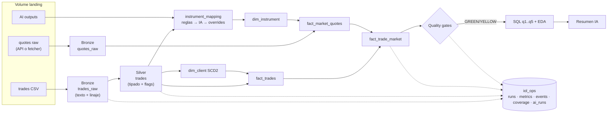

# Pipeline de operaciones bursátiles BYMA — IOL Data Engineering Challenge 2026

Pipeline medallion en Databricks (Delta Lake) que ingiere ~100k operaciones de enero–marzo 2026, las valida sin descartar registros, las enriquece con cotizaciones de mercado y publica un modelo dimensional con historia de clientes (SCD2), controles de calidad y un componente de IA.

## Estado de esta entrega

**Entrega parcial.** Lo que está acá corrió y tiene evidencia; lo que no corrió dice "no ejecutado". Ninguna cifra de este README es estimada, salvo que lo indique.

| Etapa | Estado |
|---|---|
| Entorno, Bronze idempotente, Silver y calidad | Hecho |
| Instrumentos, variantes de liquidación y mapeo | Hecho |
| Cotizaciones, imputación y cobertura por símbolo | Hecho |
| IA: enriquecimiento de instrumentos | Hecho |
| Profiling y arquitectura | Parcial: falta el benchmark de cómputo a 1x, 10x y 100x |
| Gold con estrella y SCD2 (`dim_*`, `fact_trades`) | **No ejecutado.** Diseño en ADR-006, ADR-007 y `docs/data_model.md` |
| Quality gates, monitoreo y performance | **No ejecutado.** Diseño en `docs/quality_gates.md` y ADR-012 |
| Consultas de negocio q1 a q5 y EDA | **No ejecutado** |
| Resumen de EDA con IA | **No ejecutado:** depende de las consultas |
| Orquestador `00_run_pipeline` | **No ejecutado:** los notebooks se corren en el orden de §3 |

**Entorno:** el enunciado pide Databricks Community Edition, retirada el 1/1/2026. Se usa Free Edition (ADR-001): serverless, sin clusters de pago y sin DLT.

## Índice
1. [Arquitectura](#1-arquitectura)
2. [Cómo reproducir](#2-cómo-reproducir)
3. [Orden de ejecución](#3-orden-de-ejecución)
4. [Decisiones de diseño y trade-offs](#4-decisiones-de-diseño-y-trade-offs)
5. [Calidad de datos](#5-calidad-de-datos)
6. [Modelo dimensional y SCD2](#6-modelo-dimensional-y-scd2)
7. [Cotizaciones: fuente, mapeo, imputación y cobertura](#7-cotizaciones)
8. [Observabilidad, quality gates y performance](#8-observabilidad-quality-gates-y-performance)
9. [Hallazgos de negocio](#9-hallazgos-de-negocio)
10. [Componente de IA](#10-componente-de-ia)
11. [Cómputo productivo: comparativa](#11-cómputo-productivo)
12. [Tests y orquestación](#12-tests-y-orquestación)
13. [Limitaciones y próximos pasos](#13-limitaciones-y-próximos-pasos)

## 1. Arquitectura

Detalle para mantenedores: [`ARCHITECTURE.md`](ARCHITECTURE.md) · contrato de tablas: [`docs/data_model.md`](docs/data_model.md).

**Entorno:** Databricks Free Edition (Community Edition fue retirado el 1/1/2026; ver [ADR-001](docs/decisions/ADR-001-entorno-free-edition.md)). Sin Jobs ni DLT; orquestación con `dbutils.notebook.run()`; Delta en todas las tablas.

## 2. Cómo reproducir

1. Crear cuenta en Databricks Free Edition.
2. Workspace → Git folder → clonar este repo.
3. Subir el CSV a `/Volumes/workspace/iol_bronze/landing/trades/` (el dataset original no se publica; para probar, usar `data/sample_obfuscated.csv` — ver [`data/README.md`](data/README.md)).
4. Cotizaciones: el notebook 05 las pide a las APIs, con `quotes_source = api`. Completo tarda unos 80 minutos [ESTIMADO], y si se corta sigue desde donde quedó. Si un proveedor limita los pedidos, correr `tools/quotes_fetcher` en local, subir `data/quotes_raw/` a `landing/quotes/` y usar `quotes_source = volume`: completa solo lo que falta.
5. IA: el notebook 09 usa `ai_query`, sin claves externas.
6. Correr con Run all los notebooks implementados, en el orden de §3 (widget `catalog` si no es `workspace`).
7. Tests locales: `pip install -r requirements-dev.txt && pytest -q` (Java 17+).

Notebooks ya ejecutados (con outputs): [`notebooks_executed/`](notebooks_executed/).

## 3. Orden de ejecución

| # | Notebook | Qué hace | Tablas que escribe | Estado |
|---|---|---|---|---|
| 00 | setup | Schemas y Volume | — | Hecho |
| 01 | data_profiling | Evidencia de cada decisión | — | Hecho |
| 02 | ingest_bronze | CSV → Bronze idempotente | `trades_raw`, `ingestion_runs` | Hecho |
| 03 | quality_silver | Tipado, fecha efectiva, reglas | `silver.trades`, `quality_events` | Hecho |
| 04 | instruments | Mapeo, variantes, escala | `instrument_mapping` | Hecho |
| 09 | ai_enrichment | Emisor, sector, ticker e instrumentos ambiguos | `ai_runs`, `instrument_enrichment` | Hecho |
| 05 | market_quotes | Cotizaciones, matching, cobertura | `quotes_raw`, `quote_requests`, `quote_series`, `fact_market_quotes`, `fact_trade_market`, `quote_coverage` | Hecho |
| 06 | model_gold | Dimensiones, SCD2, hechos | `iol_gold.*` | No ejecutado |
| 07 | quality_gate_monitoring | Gates + métricas + performance | `gold_status`, `pipeline_metrics` | No ejecutado |
| 08 | business_eda_sql | q1..q5 + EDA | `eda_metrics` | No ejecutado |
| 09b | ai_eda_summary | Resumen ejecutivo validado | `ai_runs` | No ejecutado |
| 00 | run_pipeline | Orquesta todo con `pipeline_run_id` | `iol_ops.pipeline_runs` | No ejecutado |

## 4. Decisiones de diseño y trade-offs

| # | Decisión | Trade-off | ADR |
|---|---|---|---|
| 1 | Free Edition respetando restricciones del challenge | Community Edition ya no existe. Serverless no da control del cluster, ni RDD ni `cache` | [001](docs/decisions/ADR-001-entorno-free-edition.md) |
| 2 | Bronze en texto + MERGE por (id, hash), sin UPDATE | Preserva lo que llegó y los conflictos, a cambio de parsear todo en Silver | [002](docs/decisions/ADR-002-ingesta-idempotente.md) |
| 3 | Sábado → fecha efectiva viernes; hora no confiable | Es una hipótesis con evidencia, sin confirmar: si es falsa, esas operaciones se comparan contra otro día. Obliga a trabajar a granularidad diaria | [003](docs/decisions/ADR-003-calendario-sabados.md) |
| 4 | Mapeo explícito de instrumentos; variantes como instrumentos distintos | Más mantenimiento que una regla de sufijo, que fallaría en `YPFD`, `C` o `BA.C` | [004](docs/decisions/ADR-004-mapeo-instrumentos.md) |
| 5 | Escala por 1 VN, factor discreto por serie; errores de escala marcados, no corregidos | Un factor discreto no absorbe un sobreprecio, y deja afuera las series que no encajan. Las filas con posible error quedan fuera de métricas hasta confirmarlas | [005](docs/decisions/ADR-005-escala-precios.md) |
| 6 | Estrella con hecho de mercado separado (diseño; `fact_trade_market` hecho, el resto no ejecutado) | Una tabla más que unir, a cambio de reprocesar cotizaciones sin tocar `fact_trades` | [006](docs/decisions/ADR-006-modelo-estrella.md) |
| 7 | SCD2 por snapshots mensuales sobre atributos derivados (diseño, no ejecutado) | El dataset no trae atributos de cliente: la historia se deriva de su actividad | [007](docs/decisions/ADR-007-segmentacion-scd2.md) |
| 8 | Cadena fija por tipo: data912, Yahoo y BYMA, según el caso | Se prioriza la serie sin ajustar sobre la oficial, y eso concentra el riesgo en un agregador personal. La validación por serie excluye ONs con sesgo | [008](docs/decisions/ADR-008-fuente-cotizaciones.md) |
| 9 | Benchmark de cierre, imputación ≤3 días hábiles, sin look-ahead | El cierre no es el precio del momento: el desvío incluye ruido intradiario. τ por tipo lo reduce, pero no lo elimina | [009](docs/decisions/ADR-009-matching-imputacion.md) |
| 10 | Cómputo productivo (diseño; benchmark no ejecutado) | La comparativa no tiene mediciones todavía | [010](docs/decisions/ADR-010-computo.md) |
| 11 | IA para enriquecer instrumentos | Completa datos que ninguna regla infiere, a cambio de validar todo y medir la calidad; no decide tipos con regla, calidad ni exclusiones | [011](docs/decisions/ADR-011-ia.md) |
| 12 | Liquid clustering en hechos (diseño, no ejecutado) | Sin medición de antes y después todavía | [012](docs/decisions/ADR-012-performance.md) |

## 5. Calidad de datos

Principio: Bronze preserva, Silver interpreta, nada se descarta. Catálogo completo: [`docs/quality_rules.md`](docs/quality_rules.md).

Medido en Free Edition sobre el CSV completo: 89.312 operaciones `OK`, 10.680 `WARNING` y 8 `ERROR`. Una operación puede tener más de una marca.

| Regla | Severidad | Filas | % | Criterio |
|---|---|---:|---:|---|
| `DQ010_SATURDAY` | WARNING | 10.255 | 10,26% | Fecha local en sábado: cola de la sesión del viernes [HIPÓTESIS, ADR-003] |
| `DQ020_EXTREME_AMOUNT` | WARNING | 415 | 0,42% | z robusto mayor a 3,5 sobre log(importe), por tipo y moneda |
| `DQ022_EXTREME_QTY` | WARNING | 107 | 0,11% | Cantidad sobre el p99,9 de su tipo |
| `DQ021_POSSIBLE_SCALE_ERROR` | ERROR | 8 | 0,01% | Precio a ×50 o ×1/50 de la mediana del símbolo |
| `DQ021_POSSIBLE_SCALE_ERROR` | WARNING | 5 | 0,01% | La misma regla en opciones, con primas volátiles |

Reconciliación: Bronze 100.000 = Silver 100.000 = `fact_trade_market` 100.000. `fact_trades`: no ejecutado.
Idempotencia: segunda corrida → 0 insertadas, 100.000 ya presentes.

## 6. Modelo dimensional y SCD2

**No ejecutado.** El diseño está en [`docs/data_model.md`](docs/data_model.md), incluido el diagrama, y el criterio de segmentación en [ADR-007](docs/decisions/ADR-007-segmentacion-scd2.md). De Gold solo existen `fact_market_quotes` y `fact_trade_market`.

## 7. Cotizaciones

Benchmark de **cierre diario**, no precio al instante: la hora del dataset no es confiable (ADR-003), y las fuentes gratuitas no dan intradiario histórico. Corrida del 2026-11-01 en Free Edition [MEDIDO].

- **Fuente y por qué:** se compararon tres fuentes sobre los 1.445 símbolos, midiendo el sesgo de cada serie contra las operaciones. La serie oficial de BYMA da precios ajustados, con 1,35% de sesgo mediano, contra 0,22% de data912 y 0,28% de Yahoo. Por eso la cadena es fija por tipo, de menor a mayor sesgo: data912 → Yahoo → BYMA en CEDEARs y acciones, data912 → BYMA en bonos, y BYMA en letras, ONs y opciones, porque es la única que las tiene. Detalle en [ADR-008](docs/decisions/ADR-008-fuente-cotizaciones.md). La API de IOL no se evaluó: requiere credenciales personales.
- **Por qué la prioridad se fija antes:** elegir la serie más parecida a las operaciones achicaría sola la métrica de "por encima del mercado". La validación solo excluye.
- **Validación por serie** (`iol_ops.quote_series`): de 2.936 series candidatas, se eligieron 593 `OK` y 145 `THIN` (menos de 5 días comparables). Quedaron afuera 684 `BIASED`, 14 `SCALE_SUSPECT` y las que no tienen datos. Resultado: 738 símbolos `MAPPED` y 707 `UNSUPPORTED`.
- **Variantes de liquidación:** el mapeo es explícito, porque el sufijo D/C no es regla: `YPFD`, `C`, `BA.C`, `AMD` y `HD` están en pesos. Cada variante es un instrumento con su propia serie, y nunca se compara una operación contra una cotización de otra moneda: 0 `CURRENCY_MISMATCH`.
- **Escala:** los bonos operan por 1 VN y las fuentes los dan por 100 VN. El factor es por símbolo y proveedor, elegido entre candidatos fijos: un factor discreto corrige la unidad y no absorbe un sobreprecio ([ADR-005](docs/decisions/ADR-005-escala-precios.md)). Las series elegidas usan ×0,01 (119), ×1/3 (2), ×1 (614), ×3 (2) y ×10 (1).
- **Imputación:** sin cotización del día, se usa el último cierre previo con hasta 3 días hábiles, y se guarda la fecha usada y la antigüedad. Son 35 operaciones, con antigüedad máxima de 2 días. Nunca una cotización posterior: 0 casos en `fact_trade_market` ([ADR-009](docs/decisions/ADR-009-matching-imputacion.md)).
- **Por encima del mercado:** `price > close × (1 + τ)`, con τ por tipo, igual a la mitad del rango diario mediano. Con el 0,5% inicial, 43,1% de las acciones daba "por encima"; con τ da 17,6%. No es una medida de sobreprecio: incluye azar intradiario.
- **Errores de API:** timeout de 10 s, 3 intentos con backoff y jitter solo en 429, 5xx y errores de conexión. Un error por símbolo queda en `iol_ops.quote_requests` y no detiene el lote; la corrida siguiente pide solo lo que falta. Hay 5 errores vigentes, todos de Yahoo: `AXIA`, `EAD`, `LND`, `MDLZD` y `TEFO`, con HTTP 400 en la descarga local. `AXIA`, `LND` y `TEFO` se cubren con BYMA; `EAD` y `MDLZD` no tienen serie válida. Un proveedor caído se probó con `FileReplayProvider` sin archivo para un símbolo: el resto sigue.
- **Cómo se obtuvo:** los primeros 600 pedidos se hicieron por API desde Free Edition, con 3 errores que se completaron después. El resto se completó desde el Volume con lo descargado por `tools/quotes_fetcher`, porque por API la corrida completa tardaría unos 80 minutos [ESTIMADO]. `quote_requests.source` registra cada caso. Lo pedido y lo guardado coinciden fila por fila en los tres proveedores.
- **Cobertura global: 93,8%** de las operaciones elegibles (93.761 de 99.992). Los 20 símbolos más operados tienen 100%. Por tipo:

| Tipo | Símbolos | Elegibles | Exactas | Imputadas | Sin dato | Excluidas por validación | Cobertura |
|---|---:|---:|---:|---:|---:|---:|---:|
| CEDEAR | 599 | 54.053 | 53.208 | 24 | 12 | 809 | 98,5% |
| BONO_SOBERANO | 98 | 18.285 | 17.653 | 3 | 0 | 629 | 96,6% |
| ACCION_LOCAL | 88 | 18.164 | 18.092 | 0 | 0 | 72 | 99,6% |
| LETRA_LECAP_BONCAP | 28 | 4.515 | 4.360 | 7 | 0 | 148 | 96,7% |
| ON | 315 | 2.550 | 103 | 1 | 22 | 2.424 | 4,1% |
| OPCION | 295 | 2.016 | 0 | 0 | 2.016 | 0 | 0,0% |
| BONO_SUBSOBERANO | 19 | 313 | 215 | 0 | 0 | 98 | 68,7% |
| WARRANT | 2 | 95 | 95 | 0 | 0 | 0 | 100,0% |
| OTRO | 1 | 1 | 0 | 0 | 1 | 0 | 0,0% |

**Dónde no llega y por qué:** en opciones no hay fuente gratuita probada: BYMA devolvió 0 filas en las 295. En ONs hay datos, pero 2.424 de 2.550 operaciones quedan excluidas por sesgo: 4,32% mediano en BYMA, su única fuente. Compararlas marcaría "por encima" casi todo. Las dos siguen en el denominador.

**Cobertura por símbolo** (top 30; tabla completa en [`docs/quote_coverage.md`](docs/quote_coverage.md)):

| Símbolo | Moneda | Tipo | Proveedor | Símbolo proveedor | Elegibles | Exactas | Imputadas | Sin dato | Excluidas | Cobertura |
|---|---|---|---|---|---:|---:|---:|---:|---:|---:|
| AL30 | ARS | BONO_SOBERANO | data912 | AL30 | 8.858 | 8.858 | 0 | 0 | 0 | 100,0% |
| AL30D | USD | BONO_SOBERANO | data912 | AL30D | 4.589 | 4.589 | 0 | 0 | 0 | 100,0% |
| MSFT | ARS | CEDEAR | data912 | MSFT | 2.336 | 2.336 | 0 | 0 | 0 | 100,0% |
| SPY | ARS | CEDEAR | data912 | SPY | 2.311 | 2.311 | 0 | 0 | 0 | 100,0% |
| AMZN | ARS | CEDEAR | data912 | AMZN | 2.054 | 2.054 | 0 | 0 | 0 | 100,0% |
| MELI | ARS | CEDEAR | data912 | MELI | 1.881 | 1.881 | 0 | 0 | 0 | 100,0% |
| PAMP | ARS | ACCION_LOCAL | data912 | PAMP | 1.668 | 1.668 | 0 | 0 | 0 | 100,0% |
| NVDA | ARS | CEDEAR | data912 | NVDA | 1.493 | 1.493 | 0 | 0 | 0 | 100,0% |
| YPFD | ARS | ACCION_LOCAL | data912 | YPFD | 1.485 | 1.485 | 0 | 0 | 0 | 100,0% |
| GOOGL | ARS | CEDEAR | data912 | GOOGL | 1.453 | 1.453 | 0 | 0 | 0 | 100,0% |
| COME | ARS | ACCION_LOCAL | data912 | COME | 1.350 | 1.350 | 0 | 0 | 0 | 100,0% |
| GLD | ARS | CEDEAR | yahoo | GLD.BA | 1.263 | 1.263 | 0 | 0 | 0 | 100,0% |
| AAPL | ARS | CEDEAR | data912 | AAPL | 1.110 | 1.110 | 0 | 0 | 0 | 100,0% |
| TXAR | ARS | ACCION_LOCAL | data912 | TXAR | 1.101 | 1.101 | 0 | 0 | 0 | 100,0% |
| ALUA | ARS | ACCION_LOCAL | data912 | ALUA | 1.059 | 1.059 | 0 | 0 | 0 | 100,0% |
| BYMA | ARS | ACCION_LOCAL | data912 | BYMA | 1.058 | 1.058 | 0 | 0 | 0 | 100,0% |
| GGAL | ARS | ACCION_LOCAL | data912 | GGAL | 993 | 993 | 0 | 0 | 0 | 100,0% |
| VIST | ARS | CEDEAR | byma_open_data | VIST 24HS | 967 | 967 | 0 | 0 | 0 | 100,0% |
| B | ARS | CEDEAR | yahoo | B.BA | 926 | 926 | 0 | 0 | 0 | 100,0% |
| HMY | ARS | CEDEAR | data912 | HMY | 907 | 907 | 0 | 0 | 0 | 100,0% |
| NFLX | ARS | CEDEAR | data912 | NFLX | 890 | 890 | 0 | 0 | 0 | 100,0% |
| PAAS | ARS | CEDEAR | yahoo | PAAS.BA | 830 | 830 | 0 | 0 | 0 | 100,0% |
| SLV | ARS | CEDEAR | yahoo | SLV.BA | 793 | 793 | 0 | 0 | 0 | 100,0% |
| CVX | ARS | CEDEAR | data912 | CVX | 751 | 751 | 0 | 0 | 0 | 100,0% |
| KO | ARS | CEDEAR | data912 | KO | 750 | 750 | 0 | 0 | 0 | 100,0% |
| META | ARS | CEDEAR | data912 | META | 729 | 729 | 0 | 0 | 0 | 100,0% |
| S17A6 | ARS | LETRA_LECAP_BONCAP | byma_open_data | S17A6 24HS | 694 | 694 | 0 | 0 | 0 | 100,0% |
| S27F6 | ARS | LETRA_LECAP_BONCAP | byma_open_data | S27F6 24HS | 663 | 662 | 1 | 0 | 0 | 100,0% |
| IBIT | ARS | CEDEAR | yahoo | IBIT.BA | 645 | 645 | 0 | 0 | 0 | 100,0% |
| NU | ARS | CEDEAR | yahoo | NU.BA | 641 | 641 | 0 | 0 | 0 | 100,0% |

## 8. Observabilidad, quality gates y performance

**No ejecutado.** Argumentos de umbrales: [`docs/quality_gates.md`](docs/quality_gates.md). Performance: sin mediciones.

## 9. Hallazgos de negocio

**No ejecutado.** Las definiciones están en [`docs/specs/08_eda_sql.md`](docs/specs/08_eda_sql.md). `fact_trade_market` ya tiene los campos que necesitan las consultas contra mercado.

## 10. Componente de IA

- **Problema:** las reglas clasifican casi todos los instrumentos, pero no pueden inferir emisor, sector ni ticker del subyacente, y 10 símbolos quedaron sin tipo.
- **Por qué IA en ese punto:** el dato de entrada es texto libre y el resultado se puede validar contra un schema. Está dentro del pipeline y solo recibe metadatos de instrumentos, nunca datos de clientes. No decide calidad ni excluye filas.
- **Integración:** `ai_query` en Free Edition, temperatura 0, lotes de 50, caché por hash de input, prompt y modelo. Cada respuesta queda en `iol_ops.ai_runs`.
- **Prompt:** [`prompts/instrument_enrichment_v1.md`](prompts/instrument_enrichment_v1.md)
- **Elección del modelo [MEDIDO]:** evaluación a ciegas sobre 60 símbolos.

  | Modelo | `asset_type` | Ticker (22 CEDEARs) |
  |---|---|---|
  | Qwen3 Next 80B (elegido) | 90,0% | 95,5% |
  | GPT OSS 120B | 83,3% | 95,5% |
  | Llama 3.3 70B | 78,3% | 95,5% |

- **Resultado [MEDIDO]:** 1.136 de 1.150 símbolos sin opciones enriquecidos; 587 de 599 CEDEARs con ticker. Tipo: 1.435 por reglas, 3 por IA, 7 por override, 0 en `NEEDS_REVIEW`. Un rerun no consulta el modelo ni cambia filas.
- **Limitaciones:**
  - Las etiquetas se escribieron con asistencia de IA, sin revisión humana independiente; se fijaron antes de ver los resultados y con 60 símbolos la diferencia es orientativa.
  - Copiar el símbolo ya acierta 90,9% del ticker, así que esa cifra dice poco. Emisor y sector no están evaluados.
  - La confianza del modelo no discrimina: un pagaré salió como letra soberana con 0,9. Por eso 7 de los 10 tipos ambiguos llevan override.
  - Con el tipo de la regla en el input, el modelo tiende a repetirlo: 0 `CONFLICT` no prueba acuerdo.
- **Secundario:** resumen de EDA validado — [`prompts/eda_summary_v1.md`](prompts/eda_summary_v1.md). No ejecutado: depende de la etapa 08.

## 11. Cómputo productivo

**No ejecutado.** Las opciones a comparar están en [ADR-010](docs/decisions/ADR-010-computo.md), sin mediciones todavía.

## 12. Tests y orquestación

Última suite completa: 333 passed, antes de la etapa 05. Con la etapa 05 son 395 tests: los 62 de cotizaciones pasan por separado, y la suite completa con el código final **no terminó de correr**. Unit e integración, con Spark y Delta en local, sin cluster. Local corre Spark 4.0.5 y Free Edition 4.2.0: los tests validan la lógica, no el comportamiento específico de esa versión (ADR-001).

Orquestador `00_run_pipeline`: **no ejecutado**.

## 13. Limitaciones y próximos pasos

- **Falta completar:** Gold con SCD2, quality gates y monitoreo, consultas de negocio, resumen de EDA con IA, orquestador y benchmark de cómputo. Ver "Estado de esta entrega".
- **Hipótesis sin confirmar:** que el sábado sea la cola de la sesión del viernes (ADR-003), y que las filas de IOLnet con precio cercano a 0,01 o 1,00 sean un valor por defecto de carga (ADR-005).
- **Cobertura:** opciones sin fuente gratuita probada. La mayoría de las ONs queda excluida por sesgo de BYMA, su única fuente. Detalle en §7.
- **Sesgo de las series:** se mide contra las mismas operaciones que después se comparan con el mercado. Un símbolo con sobreprecio sostenido quedaría excluido en vez de marcado (ADR-005).
- **Días anómalos:** el 08/01 data912 ya baja 13% en AL30 y AL30D, y el dataset sigue en el nivel anterior. Son desvíos falsos que no se corrigen (ADR-009).
- **Fuente concentrada:** data912 se declara proyecto personal, sin términos ni garantías. La API de IOL no se evaluó, porque requiere credenciales personales; podría ser mejor fuente (ADR-008).
- **IA:** las etiquetas de evaluación no tienen revisión humana independiente, y emisor y sector no están evaluados (ADR-011).
- **Con datos intradiarios** se podría comparar contra el precio del momento, si la hora del dataset fuera confiable. Con atributos reales de cliente, el SCD2 no tendría que derivarlos.
