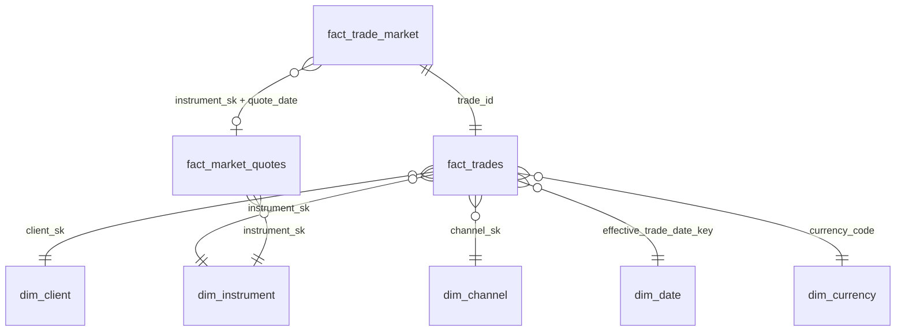

# Modelo de datos

Contrato de todas las tablas persistentes. Todas son **Delta managed tables en Unity Catalog**. Cualquier cambio de columnas se refleja acá primero.

Convenciones: `*_sk` = clave sustituta (BIGINT, determinista vía `xxhash64` de la clave natural + versión, salvo SCD2); `*_key` de fecha = INT `yyyymmdd`; timestamps en UTC (`TIMESTAMP`), fechas de negocio en hora de Buenos Aires (`DATE`).

## Diagrama

## Bronze (`iol_bronze`)

### `trades_raw` — granularidad: una fila por `id_transaccion` distinto + contenido
| Columna | Tipo | Nota |
|---|---|---|
| fecha, tipoTran, id_cliente, descripcion_titulo, moneda, simbolo_titulo, id_transaccion, origen | STRING | **originales, sin tipar** |
| cantidad, precio | STRING | originales como texto (el tipado es de Silver) |
| record_hash | STRING | sha2-256 de las 10 columnas originales concatenadas con separador `\u001f` |
| source_file, source_file_hash | STRING | ruta en Volume y sha256 del archivo |
| source_row_number | BIGINT | posición en el archivo (trazabilidad) |
| ingestion_run_id | STRING | UUID del run que la insertó |
| ingested_at | TIMESTAMP | |
| schema_version | STRING | `trades_v1` |

### `quotes_raw` — una fila por (provider, provider_symbol, quote_date, fetch_run_id)
`provider, provider_symbol, quote_date, open, high, low, close, volume, currency, raw_payload (STRING JSON), fetched_at, fetch_run_id, source_file, ingestion_run_id`

## Silver (`iol_silver`)

### `trades` — una fila por fila de Bronze (1:1)
| Columna | Tipo | Nota |
|---|---|---|
| trade_id | STRING | = id_transaccion |
| trade_ts_utc | TIMESTAMP | parse de `fecha` |
| trade_ts_local | TIMESTAMP | America/Argentina/Buenos_Aires |
| trade_date_local | DATE | fecha calendario local |
| effective_trade_date | DATE | día hábil de mercado asignado (ADR-003) |
| side | STRING | `BUY`/`SELL` |
| client_id, symbol, description_raw, currency_code, channel_code | STRING | normalizados (trim, mayúsculas donde aplica) |
| qty | DECIMAL(20,0) | |
| price | DECIMAL(24,8) | |
| gross_amount | DECIMAL(38,8) | qty × price, moneda = currency_code (escala por 1 VN, ver ADR-005) |
| quality_flags | ARRAY<STRING> | códigos de `docs/quality_rules.md` |
| quality_status | STRING | `OK`/`WARNING`/`ERROR`/`CRITICAL` (máxima severidad) |
| record_hash, ingestion_run_id | STRING | linaje a Bronze |
| silver_run_id, processed_at | | |

## Gold (`iol_gold`)

### `dim_date` — una fila por día 2025-12-01..2026-03-31
`date_key, date, year, month, month_name, day_of_week, day_name, is_weekend, is_market_holiday, holiday_name, is_business_day, prev_business_date, is_partial_period (marzo), business_days_in_month_observed`

### `dim_channel` — 5 filas + `UNKNOWN`
`channel_sk, channel_code (APP_MOBILE/WEB_DESKTOP/WEB_RESPONSIVE/API/IOLNET), channel_family (APP/WEB/API/IOLNET), is_digital_retail` — `channel_family` es agrupación descriptiva, no supone semántica comercial. Desktop y Responsive son canales distintos: `preferred_channel` se calcula sobre `channel_code`, no sobre la familia.

### `dim_currency`
`currency_code (ARS, USD), currency_name, is_foreign`

### `dim_instrument` — SCD1, una fila por `symbol` (símbolo negociable)
| Columna | Nota |
|---|---|
| instrument_sk, symbol, currency_code | |
| description_canonical | descripción elegida si hay >1 (AZN, IRS2W, X15Y6) |
| asset_type | `CEDEAR`, `ACCION_LOCAL`, `BONO_SOBERANO`, `BONO_SUBSOBERANO`, `LETRA_LECAP_BONCAP`, `ON`, `OPCION`, `WARRANT`, `OTRO` |
| asset_type_source | `RULE` / `AI` / `MANUAL` |
| underlying_key | agrupa variantes (`AL30`, `AL30D`, `AL30C` → `AL30`) |
| settlement_variant | `ARS`, `USD_MEP` (D), `USD_CCL` (C), `USD_OTHER`, `UNKNOWN` |
| price_scale_factor | multiplicador para llevar el precio del proveedor a la escala del trade (ej. 0,01 si el proveedor cotiza por 100 VN) |
| maturity_date | parseada de descripción si existe |
| issuer, sector, underlying_ticker_foreign | enriquecimiento IA (validado) |
| provider, provider_symbol, mapping_status | `MAPPED`/`UNMAPPED`/`UNSUPPORTED` |
| mapping_version, updated_at | |

### `dim_client` — **SCD2**, una fila por versión
| Columna | Nota |
|---|---|
| client_sk | BIGINT, xxhash64(client_id, valid_from) |
| client_id | clave natural |
| activity_segment | ADR-007 |
| preferred_channel | `channel_code` con más operaciones acumuladas hasta el corte; desempate: 1) operación más reciente entre los empatados, 2) alfabético (ADR-007) |
| dominant_asset_type | tipo de activo modal acumulado |
| currency_profile | `ARS_ONLY`/`USD_ONLY`/`MIXED` acumulado |
| cum_trades | métrica informativa (no forma parte del hashdiff) |
| hashdiff | sha2 de los 4 atributos versionados |
| valid_from, valid_to | DATE; `valid_to = 9999-12-31` en la vigente |
| is_current | BOOLEAN |
| snapshot_id, segment_rule_version | linaje |

Fila de versión inicial: `valid_from` = fecha de primera operación del cliente.

### `fact_trades` — **granularidad: una operación (`trade_id`)**; incluye todas las filas
`trade_id, trade_ts_utc, trade_date_key, effective_trade_date_key, client_sk, client_id, instrument_sk, channel_sk, currency_code, side, qty, price, gross_amount, quality_status, quality_flags, is_analytics_eligible, ingestion_run_id, gold_run_id`

`is_analytics_eligible = quality_status IN ('OK','WARNING')` — define qué entra a métricas por defecto (DQ021 es ERROR, por lo que queda excluido).

### `fact_market_quotes` — una fila por (instrument_sk, quote_date, provider)
`instrument_sk, symbol, quote_date, provider, open, high, low, close (escala trade), close_raw, currency_code, price_scale_factor_applied, volume, fetch_run_id`

### `fact_trade_market` — una fila por trade (1:1 con fact_trades)
| Columna | Nota |
|---|---|
| trade_id, instrument_sk, side | |
| match_method | `EXACT_DAY`, `PRIOR_DAY_IMPUTED`, `UNAVAILABLE`, `UNMAPPED`, `CURRENCY_MISMATCH`, `SCALE_SUSPECT` |
| quote_date_used, quote_age_business_days | |
| benchmark_close, day_low, day_high | |
| deviation_pct | (price − close) / close |
| position_vs_range | `ABOVE_HIGH`, `WITHIN`, `BELOW_LOW`, `NO_RANGE` |
| is_above_market | price > close × (1 + τ) — τ en config (ADR-009) |
| is_unfavorable_for_client | BUY y por encima / SELL y por debajo |
| is_comparable | match en {EXACT_DAY, PRIOR_DAY_IMPUTED} y fila elegible |

## Operativas (`iol_ops`)

| Tabla | Granularidad | Columnas clave |
|---|---|---|
| `pipeline_runs` | run × etapa | pipeline_run_id, stage, started_at, ended_at, status, rows_in, rows_out, error |
| `ingestion_runs` | run de ingesta | ingestion_run_id, source_file, source_file_hash, rows_read, rows_inserted, rows_already_present, rows_conflict, rows_duplicate_in_file, status |
| `quality_events` | evento | event_id, pipeline_run_id, trade_id, rule_code, severity, details_json |
| `pipeline_metrics` | run × métrica | pipeline_run_id, stage, metric_name, observed_value, threshold, comparator, status, details |
| `gold_status` | run | pipeline_run_id, status (GREEN/YELLOW/RED), failed_checks, warnings, decided_at |
| `quote_requests` | request | fetch_run_id, provider, provider_symbol, from, to, http_status, attempts, rows_returned, error, requested_at |
| `quote_coverage` | símbolo | symbol, currency_code, asset_type, provider_symbol, trades_total, trades_eligible, matched_exact, matched_imputed, unavailable, coverage_pct, last_error |
| `ai_runs` | invocación | ai_run_id, component, prompt_version, model, input_hash, output_json, validation_status, created_at |
| `instrument_mapping` | símbolo | tabla editable/versionada que alimenta dim_instrument (también en `src/iol_pipeline/mapping/overrides.csv`) |
| `smoke_test_results` | run de smoke test × chequeo | smoke_run_id, check, status (OK/FAIL), detail, checked_at (TIMESTAMP UTC). Evidencia del entorno (spec 00); `MERGE` por (smoke_run_id, check) |
